# Screenshots

Sendora 0.9.0 with demo data (no background image, English interface).

[Back to the documentation index](README.md)

## Sharing

**Sign-in page** with local accounts and Microsoft Entra ID:

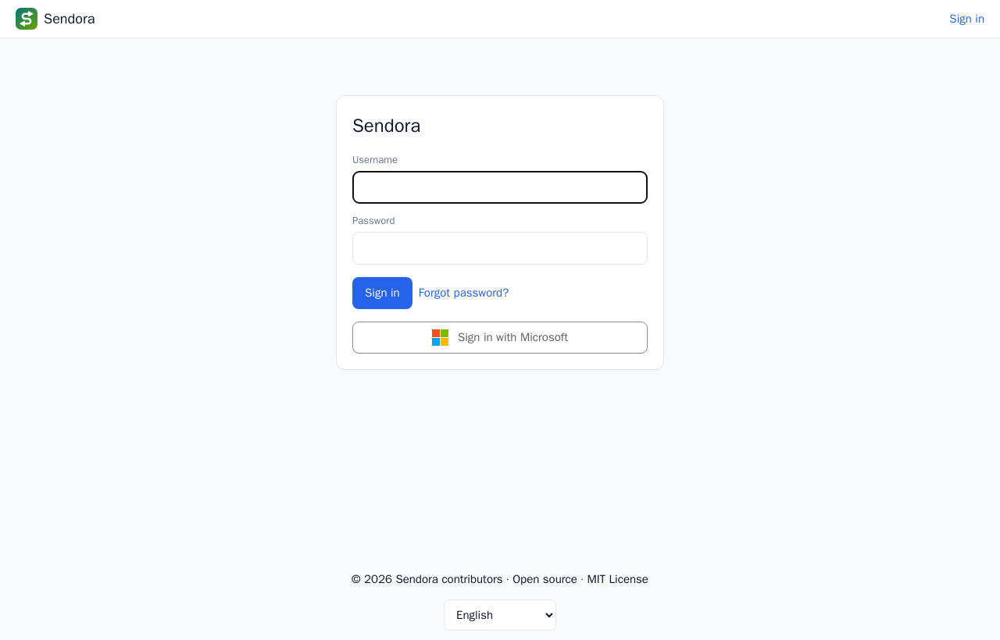

**Upload** files or whole folders:

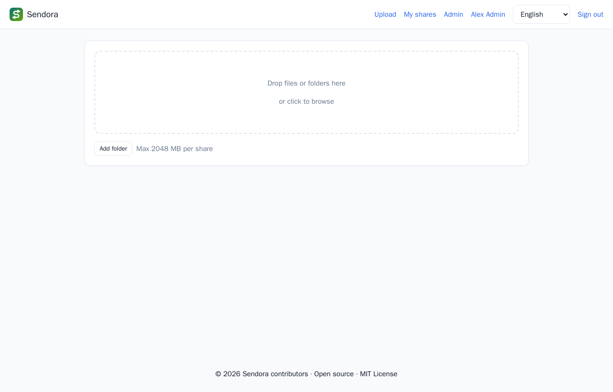

**My shares**: copy links, QR codes, expiry, download limits and history:

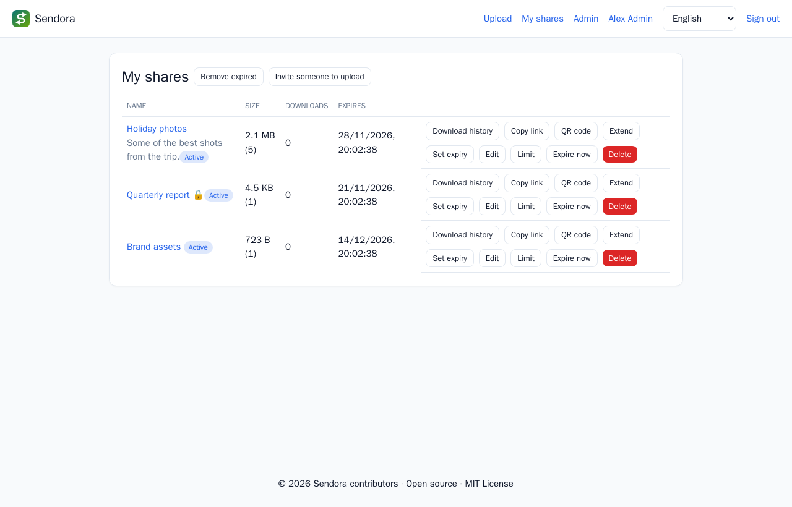

**A share** as recipients see it, in grid view with previews:

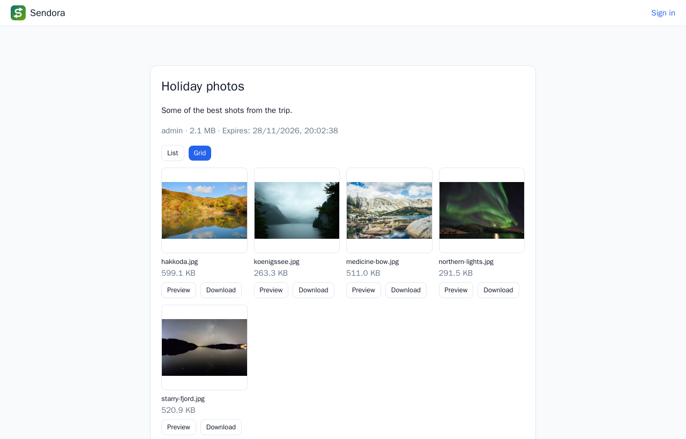

**A password-protected share**:

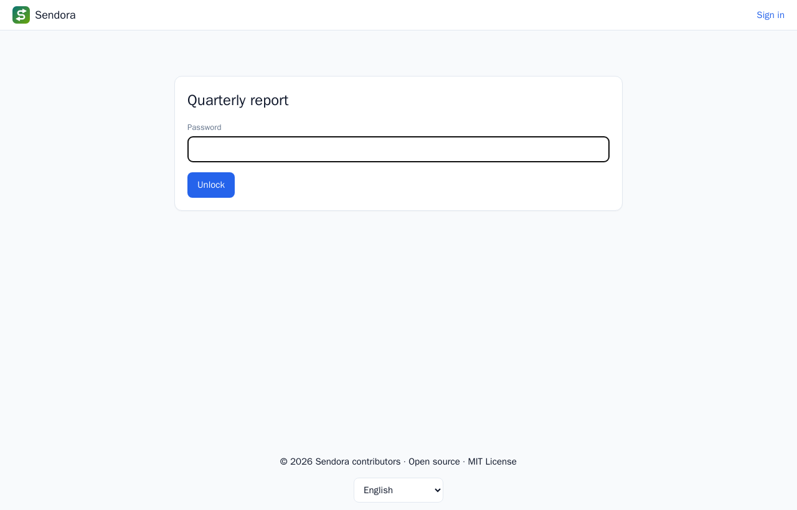

## Account

**Profile** with storage use, languages and two-step verification:

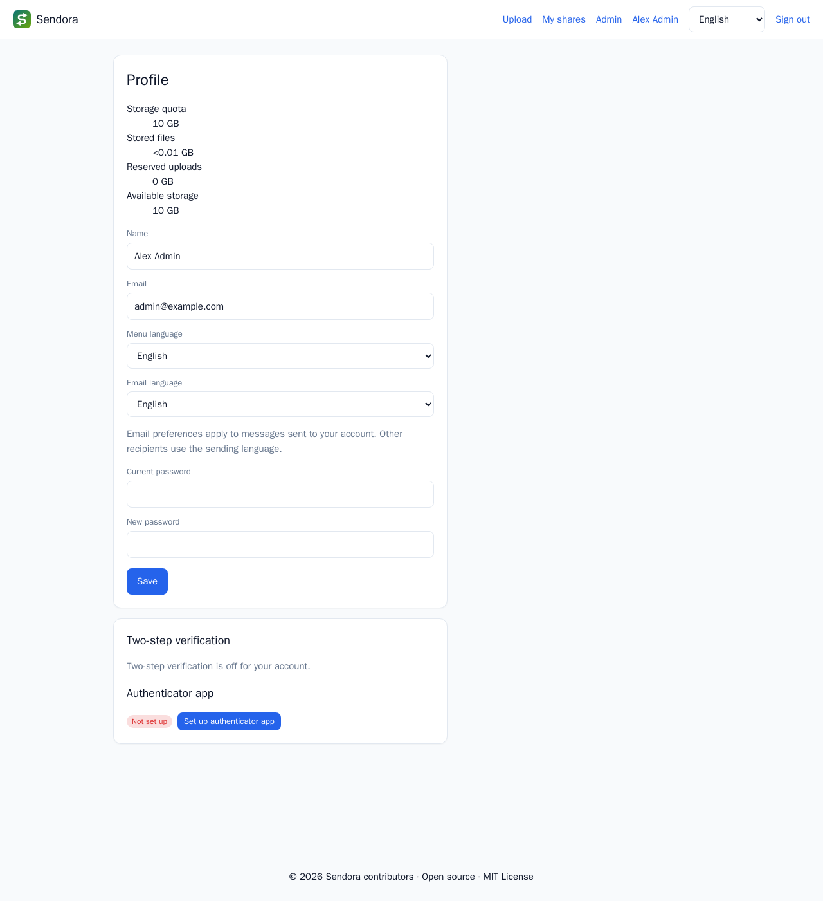

## Administration

**Users** with their source (local or a sign-in provider) and storage quota:

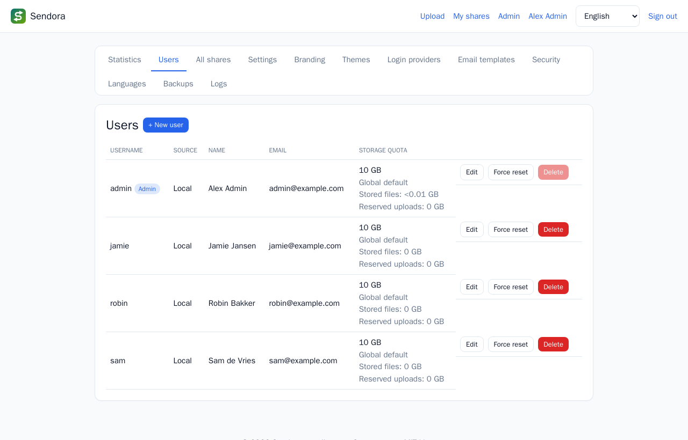

**Settings**:

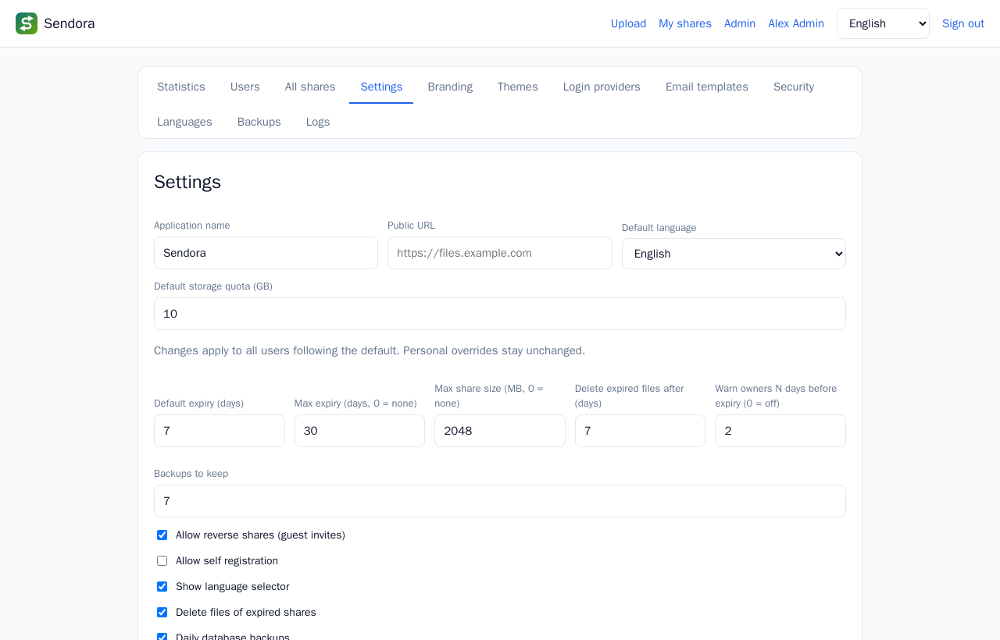

**Login providers**, here one managed by the server configuration:

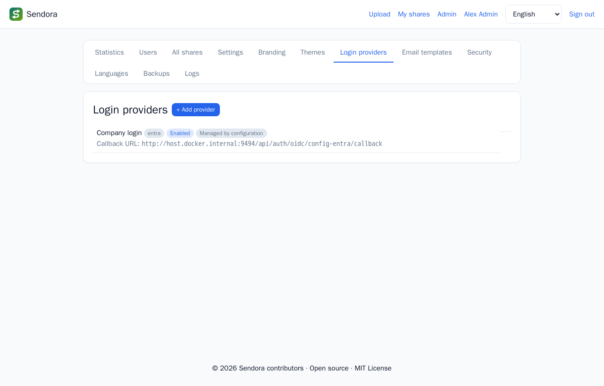

**Security**: blocking of addresses after repeated failed sign-ins:

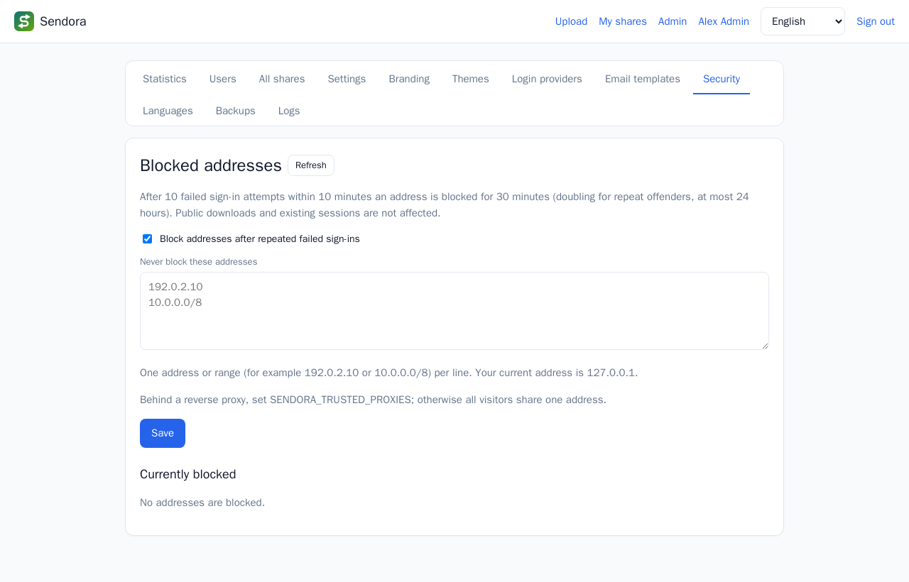

**Languages**: translate the interface through JSON:

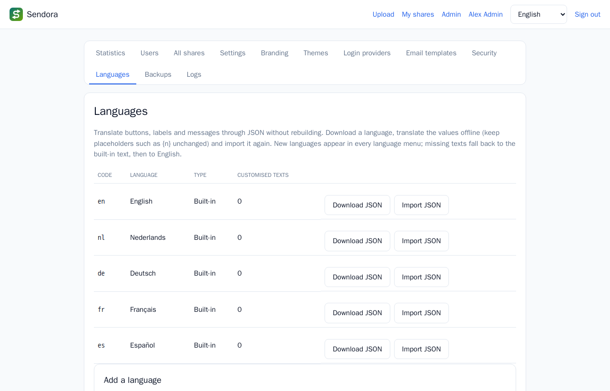
